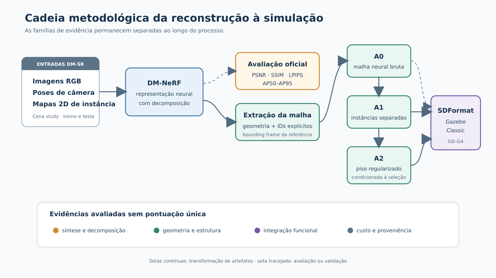
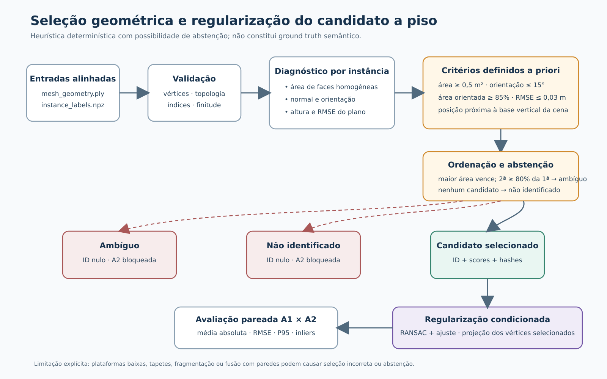
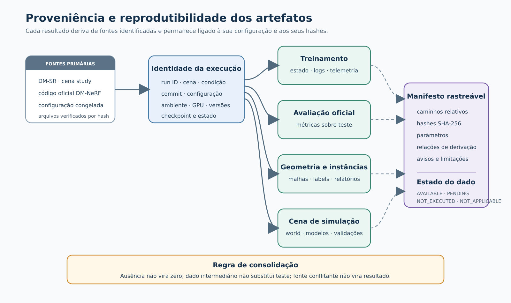

# Título provisório: Reconstrução neural de cenas domésticas estruturadas para simulação robótica

> **Versão preliminar para revisão do orientador — resultados geométricos e validação funcional ainda em consolidação.**

## 1 Introdução

A construção de ambientes virtuais para robótica exige mais do que uma representação visualmente plausível de uma cena. Em aplicações de simulação, os elementos do ambiente precisam ser descritos de forma explícita, individualizável e compatível com os mecanismos de visualização e colisão do simulador. Uma reconstrução que sintetiza novas vistas com baixo erro pode ainda apresentar superfícies descontínuas, objetos fundidos ou uma organização inadequada para manipulação no espaço virtual. Da mesma forma, uma malha que pode ser carregada por um simulador não é, por esse motivo, geometricamente fiel ao ambiente observado. Essas propriedades estão relacionadas, mas não são equivalentes e devem ser avaliadas separadamente.

Os campos de radiância neurais, introduzidos por Mildenhall et al. (2020), mostraram que uma cena estática pode ser representada implicitamente a partir de imagens com poses conhecidas, permitindo a síntese de vistas não observadas durante o treinamento. Essa formulação motivou diferentes linhas de pesquisa, entre elas a reconstrução de superfícies, o mapeamento para robótica e a incorporação de estrutura semântica ou orientada a objetos. No entanto, a saída de uma representação neural implícita não constitui automaticamente um ambiente estruturado para simulação. Para esse uso, é necessário extrair geometria explícita, preservar ou recuperar a individualidade dos elementos e produzir uma descrição de cena que possa ser carregada e testada em um simulador.

O DM-NeRF, proposto por Wang, Chen e Yang (2023), combina a representação neural da cena com sua decomposição em instâncias. O método constitui o componente neural adotado nesta dissertação e é utilizado com o conjunto de dados DM-SR. Nesse protocolo, o treinamento não recebe somente imagens RGB: também utiliza poses de câmera e mapas bidimensionais de instância. Portanto, a decomposição obtida não deve ser descrita como descoberta sem supervisão a partir de RGB, nem como resultado de um segmentador incorporado posteriormente à cadeia. A supervisão de instâncias faz parte da entrada experimental do método.

Esta dissertação investiga a etapa seguinte desse processo. O interesse central está em verificar em que medida a reconstrução neural decomposta pode ser convertida em uma representação explícita e estruturada de uma cena doméstica, adequada a ensaios de simulação robótica. A cadeia estudada compreende a reprodução do DM-NeRF no DM-SR, a extração de uma malha, a associação explícita de identificadores de instância aos vértices, a separação estrutural dos objetos, a identificação geométrica de um candidato a piso, a regularização dessa superfície e a geração de uma cena para o Gazebo Classic.

O SDFormat é utilizado como mecanismo de serialização e integração com o simulador, sem ser tratado como contribuição científica. De modo semelhante, a dissertação não propõe uma nova arquitetura de campo neural, uma nova função de perda ou um novo método de segmentação. A contribuição está na formulação e na avaliação rastreável da passagem entre a representação neural decomposta e uma representação explícita para simulação, distinguindo qualidade de imagem, decomposição, geometria, efeito do pós-processamento e funcionamento no simulador.

### 1.1 Contextualização do problema

Ambientes simulados são empregados no desenvolvimento de sistemas de navegação, percepção e planejamento robótico. Em muitos casos, esses ambientes são construídos manualmente ou derivados de modelos tridimensionais preparados previamente. A reconstrução a partir de imagens oferece uma alternativa para representar espaços existentes, mas introduz um problema de compatibilidade entre duas classes de representação. De um lado, métodos neurais podem modelar aparência e ocupação de maneira contínua e implícita. De outro, simuladores como o Gazebo Classic operam sobre entidades explícitas, organizadas em modelos, links, geometrias visuais e geometrias de colisão.

Essa diferença não é apenas uma questão de formato de arquivo. Uma cena reconstruída como uma única malha não permite, sem processamento adicional, selecionar, remover ou reposicionar um objeto independentemente. Superfícies de suporte com ruído ou deformações podem produzir contatos instáveis ou colisões espúrias. Além disso, atributos físicos como massa, atrito, inércia e articulações não podem ser deduzidos de forma geral apenas a partir das imagens usadas na reconstrução. Assim, a conversão para um simulador deve ser entendida como uma transformação com hipóteses e limites próprios, e não como uma reprodução física completa do ambiente real.

Outro aspecto é a necessidade de separar as evidências experimentais. PSNR, SSIM e LPIPS caracterizam a síntese de vistas, enquanto medidas de *Average Precision* avaliam a decomposição de instâncias no protocolo oficial do DM-NeRF. Essas métricas não medem diretamente a proximidade entre a superfície reconstruída e uma referência tridimensional. Da mesma maneira, o carregamento bem-sucedido de uma cena no Gazebo não demonstra precisão geométrica. Um protocolo adequado precisa manter essas famílias de métricas separadas e relacioná-las apenas às etapas que efetivamente podem alterar.

### 1.2 Questão de pesquisa

A questão que orienta o estudo é:

> **Em que medida uma reconstrução neural com decomposição de instâncias, combinada a pós-processamento geométrico, permite gerar ambientes domésticos estruturados para simulação robótica?**

A expressão “em que medida” indica que a resposta não será reduzida a uma decisão binária. A cadeia é examinada segundo diferentes dimensões: reprodução do componente neural, síntese de vistas, decomposição de instâncias, qualidade geométrica da malha, individualização dos elementos, planaridade do piso, integração funcional no simulador e custo computacional. O estudo não parte da hipótese de que o DM-NeRF seja superior a outros métodos. O objetivo é caracterizar o comportamento da cadeia adotada e o efeito das transformações realizadas após a reconstrução.

### 1.3 Objetivos

O objetivo geral é **avaliar a capacidade de uma cadeia baseada em DM-NeRF e pós-processamento geométrico de transformar reconstruções neuralmente decompostas em ambientes domésticos estruturados para simulação robótica**.

Para alcançar esse objetivo, são definidos os seguintes objetivos específicos:

1. reproduzir e caracterizar a reconstrução e a decomposição da cena *study* do DM-SR com o DM-NeRF;
2. avaliar a síntese de vistas e a decomposição de instâncias por meio do protocolo oficial do método;
3. analisar a geometria explícita extraída, mantendo essa dimensão separada das métricas de imagem;
4. avaliar a transformação dos identificadores de instância em objetos tridimensionais independentes, sem inferir identidade a partir das cores da malha;
5. investigar a seleção geométrica de um candidato a piso, diante da ausência de rótulo semântico oficial, e quantificar de forma pareada o efeito de sua regularização;
6. avaliar a integração da cena estruturada no Gazebo Classic por critérios funcionais previamente definidos; e
7. comparar as condições A0, A1 e A2, caracterizando também o custo computacional e as condições necessárias à reprodução do experimento, sem atribuir a uma etapa efeitos que ela não pode produzir.

### 1.4 Delimitação e contribuição

O escopo experimental está restrito ao DM-NeRF como método neural principal e ao DM-SR como conjunto de dados principal. A cena *study* é utilizada como caso experimental. Não fazem parte da cadeia proposta a substituição do DM-NeRF por outro reconstrutor neural, a introdução de um novo segmentador, a recuperação de modelos CAD ou a migração para outro simulador. Um termo de comparação externo só poderá aparecer como evidência complementar caso seja efetivamente executado e avaliado pelo mesmo protocolo geométrico; sua preparação, isoladamente, não constitui resultado.

A contribuição pretendida é uma avaliação sistemática e reproduzível da transição entre uma cena neuralmente reconstruída e decomposta e uma representação explícita voltada à simulação. Isso inclui a definição das condições de ablação, a separação das famílias de métricas, o tratamento explícito da ausência de semântica do piso, a preservação da proveniência dos artefatos e a análise das limitações introduzidas pela extração da malha e pelo pós-processamento.

## 2 Trabalhos relacionados

### 2.1 Representações neurais de cenas

O NeRF representa uma cena por uma função neural contínua que relaciona posição e direção de observação a densidade volumétrica e cor (Mildenhall et al., 2020). A renderização volumétrica dessa função permite gerar imagens a partir de pontos de vista não apresentados durante o treinamento. O método estabeleceu uma referência para síntese neural de novas vistas, mas sua formulação original não foi concebida como uma descrição explícita e estruturada para simuladores. Em particular, qualidade de renderização não implica, por si só, uma superfície adequada a colisões ou uma decomposição manipulável dos objetos presentes.

Trabalhos como NeuS, de Wang et al. (2021), e VolSDF, de Yariv et al. (2021), tratam mais diretamente da relação entre representação implícita, renderização volumétrica e reconstrução de superfícies. Esses trabalhos mostram que a obtenção de geometria requer formulações específicas e reforçam a necessidade de não usar apenas métricas de imagem para concluir sobre fidelidade geométrica. Nesta dissertação, NeuS e VolSDF cumprem esse papel de contextualização. Eles não são estabelecidos como termos de comparação experimentais nem adicionados à cadeia proposta.

### 2.2 Representações neurais em robótica

O uso de representações implícitas também alcançou problemas de mapeamento e localização. O iMAP emprega uma representação neural para realizar mapeamento e posicionamento em tempo real (Sucar et al., 2021). O NICE-SLAM, por sua vez, explora uma codificação implícita escalável para SLAM em ambientes internos (Zhu et al., 2022). Esses trabalhos evidenciam o interesse da robótica por representações contínuas e aprendidas da cena. Contudo, seus objetivos, entradas e protocolos diferem dos adotados aqui. Por isso, contextualizam a aproximação entre representação neural e robótica, mas não são usados para comparação quantitativa direta.

Para um simulador, a utilidade de uma reconstrução depende também da organização da cena. A presença de uma superfície em uma representação implícita não significa que ela esteja disponível como um objeto independente, com geometria de colisão resolvível e identidade estável no arquivo de mundo. Essa lacuna motiva o foco desta dissertação na estruturação posterior da saída neural.

### 2.3 Representações orientadas a objetos, reconstrução panóptica e real-to-sim

Panoptic Neural Fields representa a cena por campos neurais associados ao fundo e a objetos delimitados por caixas tridimensionais orientadas. O método utiliza imagens e predições auxiliares produzidas por componentes externos, incluindo poses, trajetórias de objetos e segmentações 2D, e demonstra síntese de vistas, segmentação panóptica, profundidade multivista e edição na própria representação neural (Kundu et al., 2022). A individualização pertence ao campo neural; o trabalho não propõe a exportação de cada entidade como malha de colisão nem a geração de uma cena de simulação.

Panoptic Lifting parte de imagens RGB com poses e de segmentações panópticas 2D produzidas por uma rede pré-treinada. O método trata as inconsistências de identificadores entre vistas e eleva aparência, densidade, semântica e instâncias a uma representação volumétrica implícita coerente em três dimensões (Siddiqui et al., 2023). Seu objetivo é a compreensão panóptica tridimensional e a síntese de vistas, não a obtenção de modelos físicos individualizados.

PanoRecon aproxima a reconstrução geométrica da compreensão panóptica em um regime diferente. O método recebe vídeo monocular e reconstrói em tempo real uma representação volumétrica com geometria, semântica e instâncias, combinando retroprojeção guiada por profundidade, agrupamento e rastreamento (Wu, Yan e Zha, 2024). Embora produza uma superfície reconstruída e instâncias persistentes, seu protocolo supervisionado e seu objetivo de reconstrução online não equivalem ao treinamento por cena do DM-NeRF. A publicação também não tem como saída principal um conjunto de objetos em formato de simulador.

O DM-NeRF é o trabalho mais diretamente relacionado ao componente neural adotado nesta dissertação. Wang, Chen e Yang (2023) propõem uma representação destinada à decomposição geométrica e à manipulação da cena a partir de imagens bidimensionais. No protocolo DM-SR, o método é treinado com imagens RGB, poses conhecidas e mapas 2D de instância. Sua saída permite associar regiões da reconstrução a identificadores de instância, fornecendo a base para a individualização posterior das geometrias. A manipulação demonstrada ocorre na representação neural; ela não elimina a necessidade de materializar malhas separadas, tratar faces de fronteira, registrar escala e orientação e avaliar as superfícies usadas em colisão.

Outros trabalhos partem mais diretamente do problema de geração de conteúdo para simulação. URDFormer converte uma imagem RGB em uma descrição articulada em URDF. O sistema prediz classes, relações entre partes, transformações e tipos de juntas, recorrendo a malhas predefinidas e a pares de treinamento derivados de cenas sintéticas e imagens fotorrealistas (Chen et al., 2024). Essa formulação favorece uma estrutura cinemática carregável em simulador, mas não constitui uma reconstrução multivista da superfície observada. Os autores também registram dependência da detecção, possível divergência entre os ativos predefinidos e a cena real e ausência de parâmetros físicos como massa e atrito.

DRAWER recebe um vídeo de uma cena interna estática e produz um ambiente interativo baseado em uma representação dupla: um SDF neural para a geometria e *Gaussian splats* para a aparência. O método segmenta entidades, estima articulações, aproxima formas colisionáveis e demonstra integração a motores de jogo e a uma cadeia *real-to-sim-to-real* (Xia et al., 2025). Trata-se de um trabalho próximo quanto ao destino interativo, mas suas entradas, componentes de visão, representação, inferência de articulações e protocolo de validação diferem substancialmente dos desta dissertação.

GRS recebe uma observação RGB-D, segmenta elementos da cena, produz descrições e recupera ativos compatíveis para construir tarefas e ambientes de simulação robótica (Zook et al., 2025). Sua contribuição central está na geração de tarefas, casos de teste e cenas baseadas em ativos, e não na reconstrução fiel da superfície capturada. A publicação examinada corresponde a *Generating Robotic Simulation Tasks from Real-World Images*, identificada pelo acrônimo e pelo tema real-to-sim discutidos na qualificação.

A Tabela 1 sintetiza a comparação por propriedades documentadas nas publicações. “Geometria explícita” designa a disponibilidade de uma superfície ou de ativos geométricos fora de um campo puramente implícito; não implica, por si só, fidelidade, separação em objetos ou adequação a colisões. De modo semelhante, edição no campo neural, manipulação articulada e transformação de um modelo no simulador são operações distintas.

| Método | Entrada principal | Representação e supervisão estrutural | Geometria explícita | Objetos e edição estrutural | Destino de simulação | Limitação relevante para a comparação |
|---|---|---|---|---|---|---|
| Panoptic Neural Fields (Kundu et al., 2022) | imagens e predições auxiliares 2D | campos neurais por objeto e fundo; pseudossupervisão semântica e de instância | não como saída principal | objetos e edição no campo neural | não | não exporta objetos de colisão |
| Panoptic Lifting (Siddiqui et al., 2023) | RGB, poses e máscaras panópticas 2D estimadas | campo volumétrico com aparência, semântica e instâncias coerentes entre vistas | não como saída principal | instâncias consultáveis, sem pacote estrutural para simulador | não | compreensão panóptica, não reconstrução física individualizada |
| PanoRecon (Wu, Yan e Zha, 2024) | vídeo monocular | volume com geometria, semântica e instâncias; treinamento supervisionado | sim, como reconstrução volumétrica | detecção, rastreamento e fusão de instâncias | não como objetivo | reconstrução online e protocolo de treinamento distintos |
| DM-NeRF (Wang, Chen e Yang, 2023) | RGB, poses e mapas 2D de instância | campo neural treinado por cena, com decomposição por instâncias | obtida por extração posterior | decomposição e manipulação no campo neural | não | não entrega diretamente cena explícita com colisões |
| URDFormer (Chen et al., 2024) | imagem RGB e detecção de partes | hierarquia URDF com classes, poses, partes e juntas; ativos predefinidos | sim, por ativos | objetos e partes articuladas | sim, URDF | estrutura plausível não equivale à superfície medida |
| DRAWER (Xia et al., 2025) | vídeo de cena interna estática | SDF neural, *Gaussian splats*, entidades e articulações | sim, incluindo formas para interação | entidades individualizadas e articuladas | sim | cadeia e objetivo mais amplos, sob protocolo não equivalente |
| GRS (Zook et al., 2025) | observação RGB-D | segmentação, descrição, recuperação de ativos e geração de tarefas | sim, por ativos substitutos | entidades manipuláveis conforme os ativos | sim | gera análogo funcional, não a superfície observada |
| Cadeia desta dissertação | RGB, poses e mapas 2D de instância do DM-SR | DM-NeRF, malha, IDs por vértice, malhas separadas e SDFormat | sim, por extração do campo | objetos rígidos individualizados | sim, Gazebo Classic | não infere semântica do piso, articulações ou propriedades físicas |

*Tabela 1 — Comparação qualitativa entre representações panópticas, métodos de geração de ambientes para simulação e a cadeia estudada. As células descrevem capacidades publicadas, e não resultados de um mesmo experimento. Fonte: elaboração própria a partir das obras citadas.*

Os métodos resolvem problemas parcialmente sobrepostos. Panoptic Neural Fields e Panoptic Lifting incorporam consistência semântica e de instâncias a campos neurais; PanoRecon combina reconstrução online e entendimento panóptico; DM-NeRF fornece a decomposição neural utilizada neste estudo; URDFormer, DRAWER e GRS aproximam a percepção da geração de conteúdo interativo ou de tarefas para simuladores. As entradas, entretanto, variam entre imagens multivista com poses, vídeo monocular, imagem única e RGB-D. A supervisão varia entre máscaras fornecidas, pseudorrótulos, treinamento em conjuntos anotados e dados sintéticos. As saídas variam entre campos implícitos, volumes, ativos recuperados e descrições de simulador. Essas diferenças impedem que valores publicados sejam tratados como resultados de um único benchmark.

A contribuição específica desta dissertação não é uma nova arquitetura neural nem uma alegação de superioridade sobre essas abordagens. O objeto do estudo é a transição rastreável do DM-NeRF para uma cena explícita: extração e avaliação da malha, preservação dos identificadores, individualização conservadora dos objetos, seleção geométrica auditável do piso, regularização condicionada e exportação para SDFormat/Gazebo Classic. A comparação experimental permanece separada dessa análise de literatura. A0/A1/A2 constituem uma ablação interna da cadeia e não substituem um método externo. O COLMAP+dense MVS preparado para a cena *study*, caso seja executado, servirá somente como termo de comparação geométrica, pois não fornece decomposição de instâncias, integração semântica ou cena de simulação.

### 2.4 Relação com o trabalho anterior

Resultados históricos para cenas do DM-SR foram apresentados por Lemos et al. (2025) em *Digital Environment Description and Reconstruction Using Panoptic Segmentation*, incluindo a cena *Study Room*. Esses valores pertencem ao trabalho anterior e não são tratados como reprodução do experimento de 2026. A presente dissertação estabelece uma cadeia própria de proveniência para configuração, versão do código, ponto de salvamento, registros de execução, ambiente e métricas brutas. Consequentemente, nenhum valor histórico é utilizado para preencher lacunas dos resultados atuais.

## 3 Metodologia

### 3.1 Delineamento geral

O estudo é organizado como uma avaliação experimental de uma cadeia de reconstrução e estruturação de cenas domésticas. O DM-NeRF, executado sobre o DM-SR, constitui o estágio neural. A partir do modelo treinado, são obtidas as métricas oficiais de síntese e decomposição e é extraída uma representação geométrica explícita. Essa representação é então processada para produzir objetos independentes, identificar um candidato geométrico a piso, regularizar a superfície selecionada e gerar uma cena para o Gazebo Classic.

O delineamento separa três níveis de evidência. O primeiro corresponde ao componente neural e reúne métricas de síntese de vistas e decomposição de instâncias. O segundo corresponde à geometria explícita e inclui distâncias de superfície e medidas de precisão e completude. O terceiro corresponde às transformações introduzidas pelo pós-processamento e à integração funcional no simulador. Essa separação impede que uma melhoria ou falha observada em uma dimensão seja automaticamente atribuída às demais.

A Figura 1 sintetiza a cadeia metodológica e explicita a separação entre avaliação neural, processamento geométrico e validação funcional.

*Figura 1 — Visão geral da cadeia metodológica, desde as entradas do DM-SR até a avaliação e a geração das condições A0, A1 e A2 para integração no Gazebo Classic. Fonte: elaboração própria.*

### 3.2 Conjunto de dados DM-SR

O conjunto DM-SR fornece os dados utilizados pelo protocolo oficial do DM-NeRF. Para a cena *study*, os artefatos inspecionados incluem imagens RGB, poses de câmera, mapas de instância para treino e teste, parâmetros de câmera, paleta de cores e uma malha tridimensional de referência. Foram verificados 300 mapas de instância de treinamento e 100 de teste, com resolução de 400 × 400 pixels e identificadores inteiros no intervalo observado de 0 a 12. Esses identificadores não vêm acompanhados de um catálogo semântico completo que associe cada número a uma classe do ambiente.

A malha de referência é empregada tanto na avaliação geométrica quanto pelo procedimento oficial de extração da malha. A implementação oficial obtém da referência o *oriented bounding box* que define o volume e a orientação da grade na qual o campo neural é consultado. A referência não fornece os valores de densidade previstos pela rede, mas participa da definição do domínio de extração. Por isso, a comparação posterior entre a malha prevista e essa mesma referência não é inteiramente independente.

A montagem qualitativa prevista para a Figura 2 apresentará vistas RGB originais da cena *study*, permitindo ao leitor reconhecer a aparência, o enquadramento e a diversidade das observações que alimentam a reconstrução.

> **Posição reservada para a Figura 2.**

*Figura 2 — Montagem de vistas RGB originais da cena `study`, utilizadas como entrada pelo protocolo DM-SR/DM-NeRF. Fonte: conjunto de dados DM-SR; composição do autor.*

### 3.3 Reconstrução e decomposição com DM-NeRF

O DM-NeRF recebe imagens RGB, poses de câmera e supervisão bidimensional de instâncias. O treinamento produz uma representação implícita que permite sintetizar novas vistas e estimar a decomposição da cena. A dissertação preserva o método principal e suas definições de avaliação. Adaptações introduzidas para compatibilidade de ambiente, retomada do treinamento e execução em sessões limitadas são registradas como condições de reprodução, sem alteração das funções de perda, do conjunto de dados ou do protocolo científico.

O treinamento final admite retomada com preservação do estado do otimizador, dos estados de aleatoriedade e do escalonador de precisão mista. As atualizações não aplicadas pelo mecanismo de escalonamento são contabilizadas separadamente. Ensaios preliminares de infraestrutura e desempenho servem somente para verificar a execução e dimensionar recursos, sem integrar os resultados científicos.

O avaliador oficial fornece PSNR, SSIM e LPIPS para síntese de vistas, além de *Average Precision* de instâncias nos limiares de IoU 0,50, 0,75, 0,80, 0,85, 0,90 e 0,95. Esses valores são obtidos sobre o conjunto de teste. A função de perda do treinamento, as métricas intermediárias e as medidas de desempenho computacional não são reutilizadas como substitutos das métricas de teste.

### 3.4 Extração da malha e rótulos explícitos

Após o treinamento, o campo neural é consultado no volume definido pelo procedimento oficial e convertido em uma malha triangular. A análise considera a geometria explícita, uma visualização colorida por instância, a associação entre vértices e identificadores de instância e a referência tridimensional da cena. A associação de instâncias é armazenada de modo independente da cor, por meio de um vetor `vertex_instance_id` alinhado aos vértices e triângulos da malha.

Antes de qualquer separação, são verificadas a quantidade e a ordem dos vértices, a validade dos índices de triângulos, a correspondência da topologia e a finitude das coordenadas. Essa verificação evita transferir identificadores entre malhas que apenas parecem semelhantes, mas possuem ordem ou conectividade distintas. Cores podem ser utilizadas para visualização, porém não são interpretadas como identidade semântica ou como fonte principal dos identificadores.

### 3.5 Separação estrutural dos objetos

A individualização dos objetos utiliza diretamente os identificadores explícitos associados aos vértices. Para cada instância, são selecionadas apenas faces cujos três vértices possuem o mesmo identificador. Os vértices utilizados são remapeados para uma malha independente, e cada arquivo recebe um nome determinístico derivado do `instance_id`. O procedimento registra área, limites espaciais, centroide, número de vértices e número de faces por instância.

Faces cujos vértices apresentam identificadores diferentes são classificadas como faces de fronteira e não são atribuídas silenciosamente a uma das instâncias. Sua quantidade e a cobertura de faces homogêneas são registradas, pois a omissão pode produzir aberturas nas malhas separadas. Esse tratamento prioriza rastreabilidade em relação a uma decisão arbitrária de pertencimento.

A separação não altera, por si só, a geometria das faces preservadas. Por esse motivo, ela não deve receber uma alegação de melhora em PSNR, SSIM, LPIPS ou distância de superfície. Sua evidência é estrutural e funcional: a geração de entidades independentes e a possibilidade de selecionar, remover ou reposicionar um modelo sem modificar a malha global.

A Figura 3 apresenta as transformações encadeadas de A0, A1 e A2 e delimita as evidências pertinentes a cada condição.

*Figura 3 — Condições encadeadas da ablação e famílias de evidência pertinentes a cada transformação. Fonte: elaboração própria.*

### 3.6 Identificação geométrica do piso

A inspeção dos artefatos oficiais da cena *study* não encontrou informação semântica suficiente para mapear um `instance_id` específico à classe piso. Os arquivos de poses e transformações não contêm classes; os mapas 2D possuem apenas IDs inteiros; a paleta associa IDs a cores, mas não a nomes semânticos; e os arquivos de objetos rígidos identificam alguns móveis, sem registrar o piso. A malha de referência também não apresenta propriedade de classe ou instância. Assim, nenhum ID pode ser declarado como *ground truth* semântico do piso a partir das fontes disponíveis.

Em consequência, a seleção é formulada explicitamente como uma heurística geométrica determinística. Ela recebe a malha e os rótulos explícitos da mesma extração, valida sua correspondência e considera somente faces homogêneas. Para cada instância, ajusta-se um plano a partir da covariância dos vértices das faces, com ponderação pela área dos triângulos. São registrados área, normal, altura do centro ponderado e RMSE do ajuste.

Uma instância é elegível quando satisfaz conjuntamente os critérios definidos antes da observação da malha final: área mínima de 0,5 m²; pelo menos 85% da área com orientação até 15 graus da vertical; normal do plano dentro do mesmo limite angular; RMSE máximo de 0,03 m; e altura situada até o percentil 1 das alturas da cena acrescido de 20% da amplitude vertical. O eixo vertical padrão da malha é +Y, conforme a convenção verificada para esse artefato.

Entre as instâncias elegíveis, a área total constitui o escore. A de maior área é selecionada somente se a segunda candidata possuir área inferior a 80% da primeira. Caso contrário, o procedimento retorna estado ambíguo. Se nenhuma instância satisfizer os critérios, retorna que o piso não foi identificado. Nos dois casos, o identificador permanece nulo e a etapa de regularização é bloqueada. O número do ID não é usado como critério de desempate.

A saída registra parâmetros, diagnósticos por instância e proveniência das entradas, declarando explicitamente que a evidência é uma heurística geométrica, e não um *ground truth* semântico. Essa formulação reconhece que uma plataforma baixa ou um tapete pode ser selecionado, enquanto um piso fragmentado, fundido com paredes ou incompleto pode causar abstenção. A regra produz um candidato geométrico, não uma classificação semântica comprovada.

### 3.7 Regularização do piso

Quando a seleção retorna um candidato válido, os vértices da instância são usados para estimar um plano por RANSAC, seguido de ajuste aos inliers. A regularização projeta apenas os vértices selecionados sobre o plano estimado. A topologia e os identificadores de instância são preservados. Caso seja necessário alinhar a cena ao referencial do simulador, uma transformação rígida comum pode ser registrada e aplicada de modo explícito; essa transformação não deve ser confundida com uma melhoria da reconstrução.

O efeito da regularização é medido de forma pareada sobre o mesmo subconjunto de piso antes e depois da projeção. São reportados erro absoluto médio, RMSE, percentil 95 da distância absoluta ao plano e fração de inliers. O percentil 95 é a medida primária, pois caracteriza a cauda dos resíduos sem depender apenas de valores extremos isolados. Os vértices não são tratados como replicações estatísticas independentes, pois pertencem à mesma superfície e à mesma cena.

A Figura 4 reúne os critérios de seleção, os estados de abstenção e a regularização condicionada a uma seleção válida.

*Figura 4 — Fluxo da heurística geométrica de seleção do candidato a piso, incluindo os estados de abstenção e a regularização condicionada. Fonte: elaboração própria.*

### 3.8 Geração da cena no Gazebo Classic

As condições experimentais são exportadas como mundos SDFormat para o Gazebo Classic. Cada instância recebe um nome único e estável derivado do identificador, um link, uma geometria visual e uma geometria de colisão. Visual e colisão apontam para a mesma malha triangular, com escala unitária. As referências são relativas ao diretório do mundo, de modo que o pacote possa ser movido sem depender de caminhos absolutos da máquina de origem.

A orientação vertical da malha é informada explicitamente. Quando necessário, uma rotação rígida comum relaciona o referencial da reconstrução ao eixo +Z do Gazebo. Os objetos preservam a origem comum da cena, evitando translações independentes introduzidas durante a exportação. A proveniência da cena reúne os arquivos gerados, seus identificadores, referências relativas e resumos criptográficos.

A validação estática verifica que o XML pode ser analisado, que os nomes dos modelos são únicos, que as referências de malha são resolvíveis, que as escalas são finitas e positivas e que links, elementos visuais e colisões estão presentes. Essa etapa não substitui o parser nativo do SDFormat nem um ensaio físico. Malhas não estanques ou com faces de fronteira omitidas podem ser sintaticamente válidas e ainda produzir colisões inadequadas.

## 4 Protocolo experimental

### 4.1 Unidade experimental e execução final

A cena *study* constitui o caso principal do experimento. A cadeia final parte de um único treinamento rastreável e mantém a mesma identidade experimental nos artefatos derivados. Ensaios preliminares de infraestrutura e desempenho foram utilizados para verificar a execução e estimar o custo, mas seus pontos de salvamento e métricas não integram as tabelas científicas.

A análise considera o ponto de salvamento final, o estado de treinamento, os registros por iteração, a telemetria de GPU, as métricas oficiais sobre o conjunto de teste, a malha geométrica, a visualização por instâncias, os rótulos explícitos e a referência tridimensional. Resultados parciais podem caracterizar o acompanhamento da execução, porém não substituem o estado final nem são misturados às métricas do conjunto de teste.

### 4.2 Ablação A0/A1/A2

São definidas três condições encadeadas, derivadas da mesma reconstrução:

- **A0 — DM-NeRF raw:** geometria explícita extraída diretamente do campo neural antes do pós-processamento geométrico;
- **A1 — instâncias separadas:** A0 acrescida da separação estrutural por identificadores explícitos, sem alteração intencional das coordenadas preservadas; e
- **A2 — instâncias separadas e piso regularizado:** A1 acrescida da projeção dos vértices do candidato a piso sobre o plano estimado.

A0 caracteriza a saída geométrica do estágio neural. A1 testa a individualização dos elementos, mas não deve ser comparada a A0 por métricas que a separação não altera. A2 isola o efeito da regularização sobre o piso e sobre os ensaios funcionais correspondentes. Se o seletor geométrico retornar ambiguidade ou ausência de candidato, A2 permanece bloqueada; o protocolo não força um ID para completar a comparação.

### 4.3 Métricas de síntese e decomposição

O avaliador oficial do DM-NeRF é utilizado para obter PSNR, SSIM e LPIPS sobre as vistas de teste. A decomposição é avaliada por AP50, AP75, AP80, AP85, AP90 e AP95. A linha média produzida pelo avaliador é preservada como resultado, sem recalcular uma média que a inclua novamente. Essas métricas pertencem ao estágio neural e são associadas à execução final, não individualmente a A1 ou A2.

A função de perda, o PSNR intermediário e quaisquer medidas emitidas durante o treinamento não são empregados como resultados de teste. Resultados da publicação anterior podem ser citados apenas como históricos, com sua fonte, e não são copiados para a reprodução atual.

### 4.4 Métricas geométricas

A malha reconstruída e a referência são amostradas na superfície para o cálculo das distâncias ao vizinho mais próximo em ambas as direções. São previstas a distância média da predição para a referência, a distância média da referência para a predição, a distância simétrica, os respectivos RMSEs e Precision, Completeness e F-score nos limiares de 1 cm, 2 cm e 5 cm. A amostragem utiliza 200.000 pontos e semente fixa.

Precision expressa a fração dos pontos previstos situados dentro do limiar em relação à referência; Completeness expressa a fração dos pontos da referência cobertos pela previsão; e F-score combina as duas medidas por média harmônica. Nenhuma delas é condensada com métricas de imagem ou de Gazebo em um escore único.

A interpretação dessas medidas considera que o procedimento oficial de extração da malha utiliza o *bounding frame* da própria referência DM-SR. Portanto, os resultados descreverão o comportamento da geometria dentro do protocolo oficial, e não uma reconstrução cujo domínio tenha sido determinado de forma completamente independente do *ground truth*.

### 4.5 Métricas do piso

Para o candidato selecionado, A1 e A2 são comparadas por erro absoluto médio, RMSE, P95 e fração de inliers. Os parâmetros do RANSAC, o identificador da instância e a natureza heurística da seleção acompanham os resultados. P95 constitui a medida primária da ablação. Uma redução do residual demonstra apenas maior aderência ao plano definido pelo procedimento; não demonstra, isoladamente, maior fidelidade ao piso real.

### 4.6 Validação funcional

A avaliação no Gazebo é organizada em cinco etapas. G0 verifica estaticamente a integridade do SDFormat e das referências locais. G1 verifica o carregamento da cena no Gazebo Classic sem erro fatal associado aos modelos. G2 verifica a individualização por meio da transformação independente de instâncias selecionadas. G3 verifica a utilização da superfície regularizada como apoio e colisão na condição A2. G4 corresponde a uma navegação curta e fixa, executada somente se houver configuração histórica reproduzível sem desenvolvimento adicional relevante.

G0 e G1 são aplicáveis a A0, A1 e A2. G2 é aplicável às condições com objetos separados. G3 é exclusivo de A2 e depende de uma seleção de piso válida. G4 também é restrito a A2 e pode permanecer não executado se sua reprodução exigir uma nova implementação. A ausência de execução e a não aplicabilidade são preservadas como categorias próprias; nenhuma delas é convertida em sucesso.

### 4.7 Custo computacional

O custo computacional é descrito por iteração final, atualizações efetivas, atualizações puladas pelo escalonador AMP, tempo de treinamento, tempo por iteração e uso máximo de memória. São distinguidos o pico de memória alocada pelo PyTorch e o pico de memória observado pela telemetria do dispositivo. As etapas de avaliação e extração da malha possuem tempos próprios e não são somadas ao treinamento.

O uso de recursos gratuitos constitui uma restrição prática da reprodução. Essa restrição é registrada, mas não é convertida em argumento de qualidade. Projeções obtidas em pilotos serviram ao planejamento; somente o custo observado na execução final integra os resultados científicos.

### 4.8 Reprodutibilidade e proveniência

Cada resultado final é associado à cena, à versão do código da dissertação e do código oficial, à configuração, ao ambiente, ao ponto de salvamento e à fonte correspondente. Os artefatos brutos permanecem separados das tabelas derivadas, e as fontes utilizadas recebem caminho relativo e hash SHA-256. A consolidação abrange os registros de treinamento, as métricas oficiais, as avaliações geométricas, os relatórios de piso, a estrutura das instâncias, as validações do Gazebo e, se disponível, a execução efetiva de um termo de comparação externo.

Dados ausentes permanecem distintos de execuções não realizadas e de medidas não aplicáveis. Valores não finitos, métricas fora de domínio e fontes finais conflitantes são tratados como evidência inválida, e não como resultados. Esse procedimento impede o uso de zero, campos vazios ou números históricos como substitutos de informação ausente.

A Figura 5 resume o vínculo entre as fontes primárias, a identidade da execução, os artefatos derivados e a consolidação das evidências.

*Figura 5 — Encadeamento de proveniência entre fontes primárias, identidade da execução, artefatos derivados e evidências consolidadas. Fonte: elaboração própria.*

## 5 Resultados

### 5.1 Resultados concluídos

O treinamento científico alcançou as 200.000 iterações previstas. A avaliação oficial sobre 100 vistas de teste e a extração da malha A0 também foram concluídas. Os resultados desta subseção pertencem à execução final e não são formados por métricas de treino, ensaios preliminares ou números históricos.

#### 5.1.1 Execução e custo computacional

A execução foi concluída em três sessões pertencentes à mesma sequência de treinamento, totalizando aproximadamente 30 h 58 min. Foram registradas 199.916 atualizações efetivas e 85 atualizações puladas pelo escalonamento AMP. O pico de memória alocada pelo PyTorch foi de aproximadamente 5,58 GiB, enquanto a telemetria do dispositivo registrou pico de 7.417 MiB durante o treinamento. A avaliação oficial consumiu 2.568,48 s, e a extração da malha, 109,13 s; esses intervalos são reportados separadamente do tempo de treinamento. As Tabelas 2 e 3 sintetizam, respectivamente, a execução principal e os tempos das etapas posteriores.

A Figura 6 apresenta os valores confirmados da execução sem os confundir com métricas de avaliação sobre o conjunto de teste.

*Figura 6 — Resumo descritivo da execução científica concluída em três sessões, sem inclusão de métricas de avaliação ou de teste. Fonte: elaboração própria.*

| Iteração final | Atualizações efetivas | Atualizações puladas por AMP | Tempo de treinamento | Tempo por iteração | Pico PyTorch | Pico da telemetria |
|---:|---:|---:|---:|---:|---:|---:|
| 200.000 | 199.916 | 85 | 30 h 58 min | 0,557 s/it | 5,58 GiB | 7.417 MiB |

*Tabela 2 — Execução e consumo de memória observados no treinamento científico final.*

| Etapa posterior | Tempo observado |
|---|---:|
| Avaliação oficial | 2.568,48 s |
| Extração da malha A0 | 109,13 s |

*Tabela 3 — Tempos observados nas etapas de avaliação oficial e extração da malha A0.*

#### 5.1.2 Síntese de vistas e decomposição

A Tabela 4 apresenta a linha média do avaliador oficial executado após o treinamento final sobre 100 vistas de teste. PSNR, SSIM e LPIPS caracterizam a síntese de vistas; AP50 a AP95 caracterizam a decomposição de instâncias em limiares progressivamente mais restritivos de IoU. Esses valores não são métricas intermediárias de treinamento.

| PSNR | SSIM | LPIPS | AP50 | AP75 | AP80 | AP85 | AP90 | AP95 |
|---:|---:|---:|---:|---:|---:|---:|---:|---:|
| 41,1100 | 0,9875 | 0,0260 | 0,9956 | 0,9911 | 0,9849 | 0,9769 | 0,9311 | 0,7192 |

*Tabela 4 — Métricas oficiais de síntese de vistas e decomposição de instâncias sobre 100 vistas de teste da cena `study`.*

A comparação visual prevista para a Figura 7 colocará lado a lado imagens de referência das vistas de teste e as renderizações finais correspondentes. Sua função será complementar, e não substituir, as métricas da Tabela 4.

> **Posição reservada para a Figura 7.**

*Figura 7 — Comparação qualitativa entre imagens de referência das vistas de teste e renderizações produzidas pelo DM-NeRF após o treinamento final. Fonte: conjunto DM-SR e saída do avaliador oficial; composição do autor.*

#### 5.1.3 Extração da geometria A0

A geometria A0 foi extraída do campo neural ao final do treinamento. Esse resultado confirma a conclusão do estágio de meshing e disponibiliza o artefato necessário às avaliações subsequentes. A existência da malha, entretanto, não informa sua precisão ou completude em relação à referência tridimensional. Essas propriedades dependem da avaliação de superfície descrita na Seção 4.4.

A Figura 8 será ocupada por vistas documentadas da malha A0 efetivamente extraída. Até que o render qualitativo seja incorporado, não se antecipa qualquer julgamento visual sobre sua qualidade.

> **Posição reservada para a Figura 8.**

*Figura 8 — Malha A0 extraída do campo neural após 200.000 iterações, apresentada em vistas documentadas da cena completa. Fonte: resultado do meshing final; renderização do autor.*

### 5.2 Resultados geométricos e funcionais em consolidação

A avaliação quantitativa da malha A0 contra a referência DM-SR ainda está em consolidação. Por essa razão, não são reportados neste momento valores de Precision, Completeness, F-score, distâncias direcionais, distância simétrica ou RMSE geométrico. A interpretação futura dessas medidas deverá preservar a ressalva de que o procedimento oficial de meshing utiliza o *bounding frame* derivado da referência.

A condição A1 ainda não foi concluída sobre os artefatos finais. Permanecem, portanto, sem resultado científico o número de instâncias exportadas, a cobertura de faces homogêneas, a quantidade de faces de fronteira e a demonstração de manipulação independente. Esses indicadores serão usados para avaliar estruturação, e não para atribuir melhora de imagem ou de geometria à simples separação dos objetos.

A seleção geométrica do piso ainda não foi aplicada aos artefatos finais. Não há, consequentemente, um `instance_id` declarado como piso, e a condição A2 não foi executada. Caso a heurística retorne ambiguidade ou ausência de candidato, esse estado será mantido como resultado, sem escolha manual baseada em cor ou em associação histórica. Somente uma seleção válida permitirá a comparação pareada de planaridade entre A1 e A2.

As validações funcionais no Gazebo Classic ainda não fornecem evidência para G1–G4. Assim, a presente versão não conclui que a cena carregue corretamente no simulador, que os objetos possam ser manipulados de forma independente, que o piso ofereça apoio e colisão adequados ou que uma navegação possa ser executada. O baseline COLMAP+dense MVS também permanece sem execução e não integra os resultados quantitativos.

## 6 Discussão preliminar

Os resultados concluídos permitem discutir o componente neural da cadeia, mas ainda não a cadeia completa de simulação. Na síntese de vistas, a execução final alcançou PSNR de 41,1100, SSIM de 0,9875 e LPIPS de 0,0260 sobre 100 vistas de teste. Consideradas em conjunto, as três métricas indicam elevada correspondência entre as renderizações e as imagens de referência no protocolo reproduzido: o PSNR expressa baixo erro médio em escala logarítmica, o SSIM indica forte preservação estrutural e o LPIPS reduzido indica pequena diferença perceptual segundo a representação empregada por essa métrica. Essa leitura é restrita à cena *study* e não constitui evidência de superioridade sobre métodos executados em outros conjuntos de dados ou sob outras condições.

As métricas de decomposição apresentam um comportamento informativo à medida que o critério de sobreposição se torna mais exigente. O AP permanece acima de 0,97 entre IoU 0,50 e 0,85, passa a 0,9311 em IoU 0,90 e cai para 0,7192 em IoU 0,95. A tendência é compatível com uma decomposição que encontra correspondências de instância em grande parte das vistas, mas perde desempenho quando se exige coincidência quase exata das regiões. O resultado em AP95 sugere que contornos, pequenas regiões ou diferenças locais de atribuição se tornam relevantes sob o limiar mais restritivo. Essa interpretação não identifica, isoladamente, a causa espacial dos erros; a inspeção qualitativa pareada das vistas deverá complementar a análise.

O desempenho de síntese e decomposição não resolve a questão geométrica. PSNR, SSIM, LPIPS e AP são calculados no domínio da imagem e não quantificam distância entre superfícies, completude da malha ou adequação da geometria de colisão. A extração da malha A0 demonstra que o campo treinado pôde ser convertido em uma representação triangular explícita, mas não demonstra que essa representação seja geometricamente fiel. A distinção é central para a questão de pesquisa: o estágio neural já possui evidência final, enquanto a passagem de uma saída visualmente consistente para uma cena geometricamente e funcionalmente utilizável permanece sob avaliação.

O custo observado também delimita a aplicabilidade prática. Aproximadamente 30 h 58 min foram necessárias para completar 200.000 iterações em sessões de GPU gratuita, além de cerca de 42,8 minutos para a avaliação oficial e 1,8 minuto para o meshing. O pico de 5,58 GiB alocado pelo PyTorch e de 7.417 MiB observado na telemetria mostra a diferença entre a memória gerenciada diretamente pelo framework e o consumo do dispositivo. As 85 atualizações puladas pelo escalonamento AMP foram registradas em vez de serem ocultadas, preservando a interpretação da quantidade efetiva de atualizações. Esses números caracterizam esta reprodução e não devem ser usados para comparar eficiência com trabalhos executados em hardware ou implementações diferentes.

O posicionamento frente à literatura ajuda a delimitar o que esses resultados representam. DM-NeRF, Panoptic Neural Fields e Panoptic Lifting priorizam representações neurais com estrutura de objetos ou informação panóptica. PanoRecon combina reconstrução incremental e instâncias, enquanto URDFormer, DRAWER e GRS aproximam-se mais diretamente da geração de conteúdo para simulação por meio de estruturas articuladas, representações híbridas ou recuperação de ativos. A cadeia desta dissertação ocupa uma posição mais restrita: mantém a geometria produzida pelo DM-NeRF como ponto de partida e procura torná-la explícita, individualizável e testável no Gazebo Classic. Essa escolha favorece a análise da transição entre representações, mas não acrescenta articulações nem propriedades físicas e não sustenta uma alegação de cobertura superior à dos métodos relacionados.

Por fim, a simulabilidade da cadeia completa ainda não pode ser afirmada. Para isso, não basta que a malha A0 exista ou que as renderizações apresentem métricas favoráveis. É necessário quantificar a geometria, materializar A1, avaliar a cobertura preservada na separação, aplicar a heurística de piso sem recorrer a semântica inexistente, executar A2 apenas quando o gate permitir e observar o comportamento real no Gazebo. Até que essas evidências estejam consolidadas, a resposta à questão de pesquisa é parcial: foi demonstrada a reprodução do estágio neural e a obtenção de sua saída explícita, mas não foi demonstrado que o conjunto das transformações produza um ambiente funcional para simulação robótica.

## 7 Limitações metodológicas

A primeira limitação decorre da supervisão do DM-NeRF no DM-SR. Os mapas bidimensionais de instância participam do treinamento, de modo que a decomposição não é obtida exclusivamente de imagens RGB sem rótulos. Esse fato delimita a interpretação dos APs e a generalização para cenários sem máscaras disponíveis.

A segunda limitação está na avaliação geométrica. O procedimento oficial de extração da malha usa a referência para definir o volume e a orientação da consulta. Embora a rede determine o campo reconstruído, o domínio da extração recebe informação da referência. As métricas geométricas, portanto, caracterizarão o protocolo oficial, não uma reconstrução totalmente independente do *ground truth*.

A terceira limitação é a ausência de um rótulo semântico oficial para o piso. A heurística proposta é determinística e auditável, mas suas regras de área, orientação, planaridade e altura não demonstram a classe do objeto. Pisos fragmentados, regiões fundidas e plataformas baixas podem causar erro ou abstenção. A possibilidade de não executar A2 faz parte do protocolo e não será ocultada.

A quarta limitação é a hipótese geométrica da regularização. Projetar uma superfície sobre um plano reduz os resíduos em relação ao plano por construção. Isso não garante maior fidelidade à geometria real, especialmente se a superfície verdadeira não for plana ou se a instância selecionada estiver incorreta. Por essa razão, a dissertação separa a medida de planaridade da avaliação geométrica global e da validação funcional.

A quinta limitação diz respeito à conversão para simulação. Geometria visual e geometria de colisão são derivadas da mesma malha, sem inferência de propriedades físicas. Massa, inércia, atrito, materiais, articulações e comportamento dinâmico não são recuperados. A cena resultante deve ser entendida como um ativo geométrico estruturado para os ensaios definidos, e não como um gêmeo digital fisicamente completo.

Por fim, o estudo utiliza uma cena principal e recursos computacionais gratuitos. Isso limita a diversidade de ambientes e a análise estatística entre cenas. Vértices de uma mesma malha não são considerados amostras independentes para ampliar artificialmente o tamanho experimental. As conclusões devem permanecer restritas ao caso ensaiado e ao protocolo reproduzido.

## 8 Considerações finais

Esta dissertação examina uma cadeia que parte de uma reconstrução neural decomposta e busca chegar a uma representação explícita e estruturada para simulação robótica. A proposta não modifica o DM-NeRF nem atribui contribuição científica ao SDFormat. Seu foco é tornar observável e avaliável o processo de extração, individualização, regularização e integração, com proveniência dos artefatos e separação entre as diferentes famílias de evidência.

Na etapa já concluída, o DM-NeRF foi treinado até 200.000 iterações para a cena *study*, com registro de atualizações efetivas, eventos do AMP, tempo e memória. A avaliação oficial sobre 100 vistas forneceu evidência final de síntese de vistas e decomposição de instâncias, e a malha A0 foi extraída. Os resultados mostram métricas de imagem elevadas no protocolo reproduzido e uma redução progressiva do AP à medida que a IoU se aproxima de 0,95, sem que isso seja confundido com avaliação de superfície.

Ainda não foi demonstrado que a geometria A0 seja precisa ou completa em relação à referência, que a separação A1 preserve cobertura suficiente e produza entidades funcionalmente independentes, que a heurística identifique um candidato válido a piso, que A2 melhore a condição geométrica pertinente ou que a cena satisfaça os gates de execução no Gazebo Classic. Essas verificações são necessárias para completar a resposta à questão de pesquisa, mas sua ausência não invalida os resultados já consolidados sobre o estágio neural.

Assim, a conclusão preliminar é que a primeira transição da cadeia — das observações do DM-SR para uma representação neural decomposta e para uma malha explícita — foi reproduzida com proveniência e avaliada nos domínios de imagem e instância. A transição seguinte — da malha explícita para uma cena estrutural e funcionalmente adequada à simulação — permanece em avaliação. A conclusão final deverá respeitar essa separação e limitar suas afirmações às evidências geométricas e funcionais que forem efetivamente obtidas.

## Referências

CHEN, Zoey Qiuyu; WALSMAN, Aaron; MEMMEL, Marius; MO, Kaichun; FANG, Alex; FOX, Dieter; GUPTA, Abhishek. *URDFormer: A Pipeline for Constructing Articulated Simulation Environments from Real-World Images*. Proceedings of Robotics: Science and Systems, 2024. DOI: 10.15607/RSS.2024.XX.124.

KUNDU, A.; GENOVA, K.; YIN, X.; FATHI, A.; PANTOFARU, C.; GUIBAS, L.; TAGLIASACCHI, A.; DELLAERT, F.; FUNKHOUSER, T. *Panoptic Neural Fields: A Semantic Object-Aware Neural Scene Representation*. Proceedings of the IEEE/CVF Conference on Computer Vision and Pattern Recognition, 2022.

LEMOS, João Francisco de Souza Santos; DORNELES, Gabriel Amaral; MAURELL, Igor Pardo; BRIÃO, Stephanie Loi; GUERRA, Rodrigo da Silva; DREWS JUNIOR, Paulo Lilles Jorge. Digital Environment Description and Reconstruction Using Panoptic Segmentation. In: BARROS, Edna; HANNA, Josiah P.; OKADA, Hiroyuki; TORTA, Elena (org.). *RoboCup 2024: Robot World Cup XXVII*. Cham: Springer, 2025. Lecture Notes in Computer Science, v. 15570, p. 236–246. DOI: 10.1007/978-3-031-85859-8_20.

MILDENHALL, B.; SRINIVASAN, P. P.; TANCIK, M.; BARRON, J. T.; RAMAMOORTHI, R.; NG, R. *NeRF: Representing Scenes as Neural Radiance Fields for View Synthesis*. European Conference on Computer Vision, 2020.

SIDDIQUI, Yawar; PORZI, Lorenzo; ROTA BULÒ, Samuel; MÜLLER, Norman; NIESSNER, Matthias; DAI, Angela; KONTSCHIEDER, Peter. *Panoptic Lifting for 3D Scene Understanding With Neural Fields*. Proceedings of the IEEE/CVF Conference on Computer Vision and Pattern Recognition, 2023, p. 9043–9052.

SUCAR, E.; LIU, S.; ORTIZ, J.; DAVISON, A. J. *iMAP: Implicit Mapping and Positioning in Real-Time*. Proceedings of the IEEE/CVF International Conference on Computer Vision, 2021.

WANG, B.; CHEN, L.; YANG, B. *DM-NeRF: 3D Scene Geometry Decomposition and Manipulation from 2D Images*. International Conference on Learning Representations, 2023.

WANG, P.; LIU, L.; LIU, Y.; THEOBALT, C.; KOMURA, T.; WANG, W. *NeuS: Learning Neural Implicit Surfaces by Volume Rendering for Multi-view Reconstruction*. Advances in Neural Information Processing Systems, 2021.

WU, Dong; YAN, Zike; ZHA, Hongbin. *PanoRecon: Real-Time Panoptic 3D Reconstruction from Monocular Video*. Proceedings of the IEEE/CVF Conference on Computer Vision and Pattern Recognition, 2024, p. 21507–21518.

XIA, Hongchi; SU, Entong; MEMMEL, Marius; JAIN, Arhan; YU, Raymond; MBIZIWO-TIAPO, Numfor; FARHADI, Ali; GUPTA, Abhishek; WANG, Shenlong; MA, Wei-Chiu. *DRAWER: Digital Reconstruction and Articulation With Environment Realism*. Proceedings of the IEEE/CVF Conference on Computer Vision and Pattern Recognition, 2025, p. 21771–21782.

YARIV, L.; GU, J.; KASTEN, Y.; LIPMAN, Y. *Volume Rendering of Neural Implicit Surfaces*. Advances in Neural Information Processing Systems, 2021.

ZHU, Z.; PENG, S.; LARSSON, V.; XU, W.; BAO, H.; CUI, Z.; OSWALD, M. R.; POLLEFEYS, M. *NICE-SLAM: Neural Implicit Scalable Encoding for SLAM*. Proceedings of the IEEE/CVF Conference on Computer Vision and Pattern Recognition, 2022.

ZOOK, Alex; SUN, Fan-Yun; SPJUT, Josef; BLUKIS, Valts; BIRCHFIELD, Stan; TREMBLAY, Jonathan. *GRS: Generating Robotic Simulation Tasks from Real-World Images*. Proceedings of the IEEE/CVF Conference on Computer Vision and Pattern Recognition Workshops, 2025, p. 594–603.
